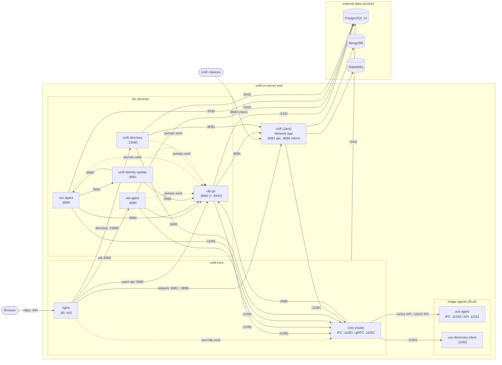

# UniFi OS Server on Kubernetes (Helm chart, no systemd)

A Helm chart that runs the services of the UniFi OS Server image
(`ghcr.io/unihosted/unifi-os-server-docker`) as one pod with one container per
service, without systemd and without a custom image. PostgreSQL, MongoDB and
RabbitMQ are external; the chart is tested against CloudNativePG (optionally
with db-operator for databases and roles), the MongoDB Community operator and
the RabbitMQ Cluster Operator.

This directory is the chart and also holds its development material (tests,
examples, notes); the latter is excluded from the package by `.helmignore`.
Paths below are relative to this directory; commands are run from the
repository root.

- End-to-end test: [`test/e2e`](test/e2e) (kind + the three operators).

This README collects how the stack works and the non-obvious findings behind
it, for maintenance and image upgrades.

## Layout

- The chart, based on `helm create`:
  - `templates/`, `values.yaml`.
  - `files/scripts/` — entrypoints (`run-*.sh`), the shared helpers
    `lib.sh` (config rendering, Postgres checks) and `as-user.sh` (directory
    setup and privilege drop), and `fake-sd1.js` (fake systemd D-Bus provider
    for core). Shipped as a ConfigMap mounted at `/scripts`.
  - `files/config/` — static property overrides per Go service and their
    stdout-only logger configs (see Logging).
  - `values.schema.json`, `README.md.gotmpl` (rendered with `helm-docs`),
    `ci/` (values for `ct lint`).
- `test/e2e/` — kind cluster config, operator and data-service setup, chart
  values, the test script, and an optional RabbitMQ TLS overlay.
- `examples/cnpg/` — manifests for a CloudNativePG cluster that works with
  the chart (roles, databases, role Secrets, chart values).
- `docs/loopback-addresses.md` — why the services have to share a network
  namespace (reverse-engineering results).
- `ct.yaml` — chart-testing configuration.

## Architecture

Runtime interactions. Solid edges are TCP, dashed edges are unix sockets in
the pod's shared `/run`. Ports are the loopback ports inside the pod. Basis:
unifi-core's `default.yaml` and generated nginx upstreams, the apps'
`config.props`, and live `ss` sampling of a running stack; it is a map of what
we know calls what, not a packet capture.

All containers of the pod start together. Ordering is handled in the
entrypoints: core waits for PostgreSQL (`pg_isready`), the Network app waits
for core's API (`/api/info`), and the Go services simply restart until their
dependencies answer (normally they do not need to).

Not in the picture on purpose: the other UniFi OS applications (credential
server `:9580`, Access `:12080`/`:9780`, wireguard `:6082`, Protect `:7080`,
Drive `:16080`, Talk, Connect, ...). They are **not installed in the image**:
`dpkg -l` shows only `unifi` (Network), `unifi-core`, `uos`, `uos-agent`,
`uos-discovery-client`, `ulp-go`, `uid-agent`, `ucs-agent`, `unifi-directory`,
`unifi-identity-update` and mongodb. There are no packages, binaries or
systemd units for the others; only leftover system users (`unifi-access`,
`unifi-protect`, ...) and a stray `unifi-access.service.d` drop-in. The ports
come from configuration shared with other console types, so those loopback
ports stay "connection refused", as on any console with only the Network app.
Core can apparently install applications at runtime
(`/api/applications/<id>/install`); that has not been tried and would conflict
with the stock-image rule.

## One pod: the services must share a network namespace

The apps talk to each other over `127.0.0.1:<port>` and assume one network
stack, as under systemd. A Kubernetes pod gives exactly that: one container
per service, one network namespace, an `emptyDir` for `/run` (unix sockets:
`/run/ulp-go/jsonrpc.sock`, the D-Bus socket used by `uos-agent`). An image
upgrade that adds a port or a new call between services needs no change.

The pod sandbox owns the namespace, so any container can restart without
affecting the others. (In the earlier Docker Compose version, the namespace
owner had to be an idle holder container: when the owning container
restarted, every container joined to it kept a dead namespace.)

### Why not separate pods?

Investigated in depth (source reading of core's JS, disassembly of the Go and
Rust binaries, decompilation of the Java app, plus live tests); results and
evidence are in [docs/loopback-addresses.md](docs/loopback-addresses.md).
Some addresses are configurable, but every component still has at least one
literal `127.0.0.1` peer or listen address in its code (core binds its IPC and
gRPC servers to loopback and hardcodes the host in ~25 of ~30 calls).
Separate pods would need per-port loopback forwarders. A version with `socat`
forwarders existed (commit "No more network namespace sharing") and was
dropped: it needed a table of every port and owner, a missing entry only shows
as "connection refused" on some code path, finding the edges took reverse
engineering that would have to be redone per upgrade, and plain TCP readiness
checks become meaningless (the local forwarder always accepts; this is why
`run-unifi.sh` waits with an HTTP request).

## External data services: what each component needs

Established by reading the code; see the chart README for the user-facing
summary.

| Component | PostgreSQL | MongoDB | RabbitMQ |
|---|---|---|---|
| `unifi-core` | any user (node config `postgres.*`; `pg_dump`/`pg_restore` for backups read `PG*` env) | – | – |
| `ulp-go` | user **`ulp-go`**, DBs `ulp-go` + `ulp-go-syslog` | – | – |
| `uid-agent` | user **`uid`**, DB `uid` | – | – |
| `ucs-agent` | user **`ucs-agent`**, DB `ucs-agent` | – | – |
| `unifi-directory` | user **`unifi-directory`**, DB `unifi-directory` | – | – |
| `unifi-identity-update` | – (no Postgres driver in the binary) | – | – |
| `unifi` (Java) | – (only with `unifi.active.db.mode=postgresql\|combined`; default `mongo`) | `db.mongo.uri`, `statdb.mongo.uri` | `rmq.*` and Spring `spring.rabbitmq.*` |

### PostgreSQL must be version 14

`ulp-go` (xorm fork) always emits `... c.relname = $1AND s.table_schema = $2 ...`
(no space after `$1`). PostgreSQL <= 14 accepts that; 15+ rejects it with
`trailing junk after parameter`, which panics `ulp-go` on any boot where tables
already exist. The stock image bundles PostgreSQL 14. Do not use a newer
server. (PostgreSQL 14 is end of life from November 2026; there is no fix short
of patching the binary.)

### PostgreSQL: one fixed-name role per Go service

The Go services' schema migrations are plain SQL files in the image
(`/usr/lib/<app>/migrations/*.up.sql`, `pg_dump` style) containing literal
`OWNER TO "ulp-go"` (resp. `uid`, `ucs-agent`, `unifi-directory`); there is
no templating and no setting for it. Counted for 5.1.42 (case-insensitive;
`ulp-go` and `ucs-agent` write `owner to`): ulp-go 53 in 8 files, uid-agent
74 in 7, ucs-agent 5 in 4, unifi-directory 14 in 11. To re-check after an
image upgrade: `grep -ic "owner to" /usr/lib/*/migrations/*.up.sql`. Logging in
as another user fails on the first migration with `role "ulp-go" does not
exist` and leaves `schema_migrations` marked dirty (`Dirty database version
... Fix and force version` on every following start; the database has to be
recreated or the row fixed by hand). The chart therefore takes the
credentials per service, and the entrypoint refuses to start a Go service
whose username does not match (`pg_check_user` in `lib.sh`).

Strictly, PostgreSQL only needs the session user to be a *member* of the role
named in `OWNER TO`; on PostgreSQL 14 a login role that is a member of a
`NOLOGIN` role `ulp-go` could create a table and hand it to that role (checked
with throwaway roles, not with the services). That would allow arbitrary
login names, but `pg_check_user` would have to be relaxed, and it is untested
with the real migrations. Each role needs full privileges on
its database: owning it (CloudNativePG `Database` with `owner`), or `ALL` on
the database and on schema `public` (what db-operator grants its main user;
the database itself is then owned by the admin user, which works).

Other PostgreSQL constraints of the Go services, from their DSN template
`host=%s port=%d user=%s password=%s dbname=%s sslmode=disable`:

- no TLS (`sslmode=disable` is compiled in);
- the password is inserted unquoted, and their config files are read with
  `${...}` expansion: passwords with whitespace, quotes, backslashes or `$`
  are rejected by the entrypoint (`pg_check_password`).

`ulp-go` has a second database (its activity log: tables `systemlog`,
`event`, `actor`, `target`, `authentication`, `json_systemlog`; created by
the ORM at start, no `schema_migrations`). The only setting for it is
`db.systemlog.name` (the sole `db.systemlog.*` string in `ulp-go-app`), so it
always uses the main connection's host, port, user and password; the chart
exposes just `postgresql.auth.ulpGo.syslogDatabase`.

The chart's connection values for all three data services
(`postgresql.auth.<service>`, `mongodb`, `rabbitmq`) take every field
separately, either from a Secret key (`name` defaults to the section's
`secretName`) or as a plain `value` (not for passwords; a `password.value`
fails the install). This fits operators whose Secrets hold only part of the
settings:

- CloudNativePG managed-role Secrets have just `username` and `password`;
  host and port can come from the cluster's `-app` Secret (see
  `examples/cnpg`).
- The MongoDB operator's `<resource>-<db>-<user>` Secret has `username`,
  `password` and full connection strings, no hosts or replica set: those are
  plain values. (The connection strings are not used: the app needs two
  databases and its own options.)
- The RabbitMQ Cluster Operator's `<cluster>-default-user` Secret has `host`,
  `port`, `username` and `password`, the chart's default keys, so
  `rabbitmq.secretName` alone is enough, also with TLS: the operator then
  switches the Secret's `port` to 5671 (checked with v2.23.3).

`value` wins over `key`, because Helm merges the defaults (`{key: host}` ...)
with user values. Defaults that are plain values (database names,
`mongodb.authSource`/`database`/`statDatabase`) live in the template
(`unifi-os-server.fieldDefaults`) rather than in `values.yaml` for the same
reason: a user-set `key` would otherwise be shadowed by a default `value`.

The settings reach the Go services through `/etc/<app>/config.props` (on
each app's `overrides` list), rendered at container start from
`files/config/<app>.props` plus the database environment variables. The
stock `pre-start.sh` (`<app> init`) is not run: it only creates roles and
databases (external now) and chowns directories.

### PostgreSQL with db-operator

[db-operator](https://github.com/db-operator/db-operator) (`kinda.rocks`)
works with the chart; tested with 2.44.0 (chart 3.17.0) against a CloudNativePG
server, see `test/e2e/postgres-db-operator.yaml`. Findings:

- db-operator names the database and the user `<namespace>-<Database name>`,
  which cannot match the fixed role names. It reuses a credentials Secret that
  already exists (`POSTGRES_DB`, `POSTGRES_USER`, `POSTGRES_PASSWORD`), so for
  the four Go services the Secret is created up front with the fixed user
  name; the password then has to come from whoever creates it.
  `unifi-core` can use a generated Secret.
- Its Secrets have `POSTGRES_DB`, `POSTGRES_USER` and `POSTGRES_PASSWORD`
  but no host or port; `test/e2e/values-db-operator.yaml` maps them and sets
  host and port as plain values.
- `ulp-go` needs a second database for the same user: a second `Database`
  with `spec.existingUser: ulp-go` gives it the main-user privileges without
  creating or deleting the role. Its name is generated
  (`<namespace>-ulp-go-syslog`) and read from that Database's Secret via
  `postgresql.auth.ulpGo.syslogDatabase`.
- `DbUser` is not used: its access types (`readOnly`, `readWrite`) only grant
  DML on existing tables, while the Go services run their own schema
  migrations. It happens to work on PostgreSQL 14 (where `public` is writable
  by everyone), but the tables would then not be owned by the Database's user.
- db-operator 2.44 serves `DbInstance` only as `v1beta1`
  (`adminSecretRef` with capitalised `Namespace`/`Name`, `generic.host/port`);
  the `v1` API in its main branch is not released yet. The admin Secret is
  read from the keys `user` (default `postgres`) and `password`, which fits
  CloudNativePG's `<cluster>-superuser` Secret (`enableSuperuserAccess: true`).
- Deleting a `Database` drops its database and then tries `DROP USER` (unless
  `existingUser` is set); the role only survives if it still owns objects
  elsewhere (db-operator ignores that error). Set `deletionProtected: true`
  outside of tests.

### MongoDB: roles

UniFi Network 10.5 uses `ace`, `ace_stat`, `ace_audit` (new; found through
`not authorized on ace_audit`) and runs `serverStatus`. The user needs
`dbOwner` on `ace`, `ace_stat`, `ace_audit` and `ace_restore`, and
`clusterMonitor` on `admin`. The database names other than `ace`/`ace_stat`
are built at runtime and do not appear as literals in the jar. Credentials
are put into the URIs URL-encoded by `run-unifi.sh`.

### RabbitMQ: Spring properties are what count

The Network app has a `ConnectionFactoryCustomizer` that applies `rmq.host`,
`rmq.port`, `rmq.username`, `rmq.password` from its `system.properties`. With
only those set, it still connected to `127.0.0.1` (connection refused). The
broker address took effect through Spring Boot's own `spring.rabbitmq.*`
properties, which `run-unifi.sh` passes as `SPRING_RABBITMQ_*` environment
variables (not `-D` flags, to keep the password off the command line). TLS
uses `spring.rabbitmq.ssl.*` with a trust store built from the CA in a
Secret. The compose version's client-certificate setup is not needed with the
RabbitMQ Cluster Operator; whether some feature needs devices to reach the
broker with client certificates (`unifi.rmq.certificates`) is unknown.

## UniFi OS core

### nginx must be running before core starts

Core writes its nginx site configs and immediately runs `sudo nginx -s
reload`; if that fails (`invalid PID number "" in "/run/nginx.pid"` when nginx
is not running), the rejection is unhandled and core's `unhandledRejection`
handler shuts down and calls `process.exit()` (exit code 0, `app.log`:
`unhandledRejection, shutting down...`). `run-unifi-core.sh` therefore creates
`/data/unifi-core/logs` (nginx.conf writes `nginx-access.log` there; its
absence was the only reason `nginx -t` failed on fresh storage) and starts
nginx synchronously before core. If `unifi-core` shows a restart after a first
boot, this has regressed.

### Thread pool vs. PID limits

The stock unit sets `UV_THREADPOOL_SIZE=256`. Every libuv thread counts against
the container's/pod's PID limit; when thread creation fails, node aborts
before writing any log (`Aborted`, exit 134, no `app.log`). Seen in a test
cluster with a per-container limit of 184 tasks. The chart keeps 256 by
default and exposes `containers.unifiCore.uvThreadpoolSize`. Clusters with a
low `podPidsLimit` need it lower, or a higher limit.

### Other core notes

- The `pre-start` hook runs as `unifi-core` and logs permission errors
  (`/srv/unifi-core`, `/etc/nginx/nginx.conf`); harmless, the entrypoint does
  those steps as root.
- Console identity (`/usr/lib/{platform,product_name,app_model,version}`) is
  not in the image; the chart mounts it from a ConfigMap. The version string
  defaults to `UOSSERVER.0000000.<image tag>.000000.0000.0000`.
- The device UUID (`/data/uos_uuid`) is derived from the release namespace and
  name unless set, so it is stable across upgrades and `helm template`
  renders.

## Go services drop privileges in the entrypoint

Each Go container starts as root only long enough for `as-user.sh` to create
and chown its directories, then `exec`s the app via `setpriv` as the app's own
user (PID 1, signals delivered directly).

- **Users** (resolved inside the image, uids as of 5.1.42): `ulp-go` 999,
  `uid` 991, `ucs-agent` 975, `unifi-directory` 979, `ucs-update` 974 for
  identity-update. `--init-groups` applies supplementary groups from the
  image's `/etc/group` (`ucs-update` is in `ucs-agent`); a pod-level
  `runAsUser` would drop those. Re-check with `getent passwd` when upgrading.
- **Why a root step at all:** the PVC subdirectories, `/run/<app>` and the
  stock image's root-owned files need preparing. `as-user.sh` only chowns
  recursively when a listed directory's owner is wrong, so restarts are cheap.
  **List every directory explicitly, parents first:** `mkdir -p` creates
  missing parents as root and only listed directories are chowned.
- Core and the Network app still use `runuser` from their entrypoints, like
  their systemd units. The pod therefore needs Pod Security level `baseline`.
- `uid-agent` leaves a root-owned `devnull` file in `/data/uid`: the app runs
  `systemctl` via sudo (fails, no systemd) with a relative `devnull` redirect.
  Harmless.

## Logging goes to stdout/stderr

All Go services log to `kubectl logs`. Each needed its own mechanism; none
has a single "log to stdout" switch:

- `files/config/logger/<app>.yaml` replace the stock logger configs (mounted
  over `/usr/lib/<app>/configs/logger/prd.yaml` for `ulp-go`, `ucs-agent`,
  `unifi-identity-update`, and `/usr/lib/uid-agent/logger.yaml`). They set
  `std: true` and reduce the mandatory `default` file group to level `error`:
  the logging library always keeps a `default` group that writes one
  `<prefix>.log` per logger prefix and re-adds it with defaults if absent;
  levels above `error` are not accepted and silently fall back to `info`.
  These are trimmed copies; diff them against the image's originals when
  upgrading.
- `log.redirect_std_output = false` stops the apps from capturing their own
  stdout/stderr into `std.log`/`std.err.log`, so panics show up in the
  container log. `uid-agent` uses `log.std_to_file.enable = false`.
  `log.metrics.enable = false` stops `ulp-go`'s daily metrics file.
- `unifi-directory` has no logger YAML (`log.std = true`); its
  `all.log`/`info.log`/`error.log` are hard-wired.
- `log.file = false` has **no effect** in any of them. The remaining internal
  log directories are size-capped in-memory `emptyDir` volumes, so nothing
  persists or fills the PVC.

The Network app and core still write their own log files to the PVC
(`/data/unifi/logs`, `/data/unifi-core/logs`).

## Testing

`charts/unifi-os-server/test/e2e/setup.sh` creates a kind cluster with cert-manager, CloudNativePG,
mongodb-kubernetes and the RabbitMQ Cluster Operator plus the data services
(PostgreSQL roles and databases from CloudNativePG, or from db-operator with
`POSTGRES_PROVISIONER=db-operator`);
`charts/unifi-os-server/test/e2e/run.sh` installs the chart and checks that all containers become
ready without restarts, runs `helm test`, and waits for the setup wizard in a
headless browser. See [test/e2e/README.md](test/e2e/README.md).

Static checks: `ct lint --config charts/unifi-os-server/ct.yaml`, `helm-docs` for the chart README,
and `helm template ... | kubeconform -strict` (Kubernetes 1.26 and current).

## Known gaps

- The setup wizard is verified to render, not to complete (admin account,
  adoption of a device).
- `uos-discovery-client` runs but cannot see the LAN from a pod network
  (layer-2 discovery). Devices must be adopted via `set-inform`, DHCP option
  43 or DNS.
- `console.systemIP` (`system_ip`) is passed to the Network app; its effect on
  the inform address has not been verified with a real device.
- Image units deliberately not run: cron, snmpd, smartmontools, epmd.
- `GET /api/v2/identity/status` returns 404 without a session (the agent's API
  answers 404 for unauthenticated/unknown paths); a 500 `ECONNREFUSED :11011`
  would mean `uos-agent` is down.
