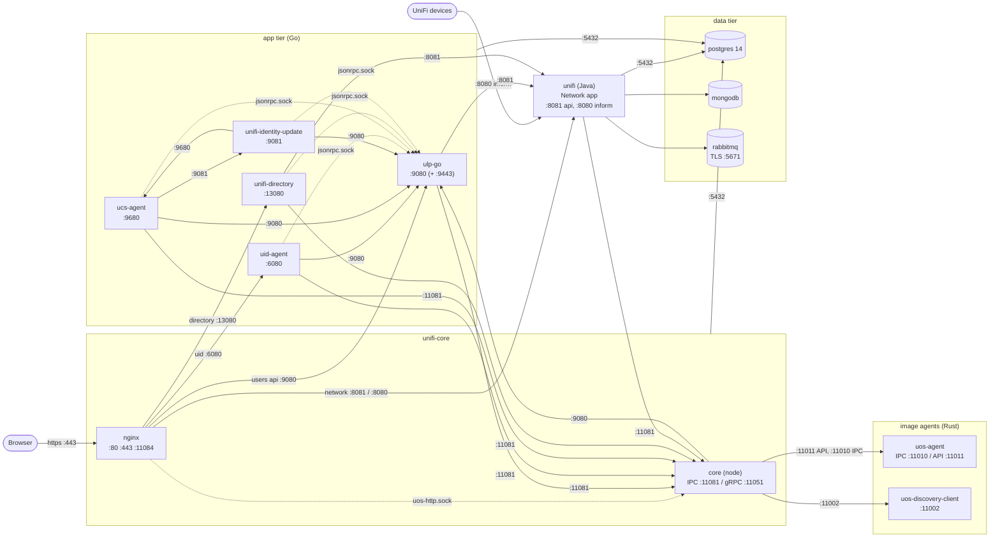
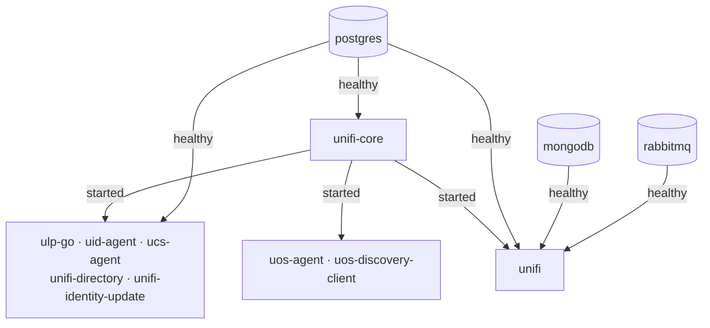

# UniFi OS Server 5.1.42 — Docker Compose (no systemd)

Runs the UniFi OS Server components from the official
`ghcr.io/unihosted/unifi-os-server-docker:5.1.42` image as separate foreground
compose services. No systemd anywhere; data tier is all-official images.

## Services

| Service | Role |
|---|---|
| `unifi-core` | OS core (nginx, D-Bus, ucore API). |
| `uos-agent`, `uos-discovery-client` | Image units `uos-agent` (serves the `uosAgent` API on 127.0.0.1:11010/11011 that unifi-core calls) and `uos-discovery-client` (Rust, run as root like in the stock image). |
| `unifi` | UniFi Network Application (java). 8080/8081 internally. |
| `ulp-go` | ULP app framework (Go). 9080/9443 internally. |
| `unifi-directory` | Directory (Go). 13080 internally. |
| `ucs-agent`, `unifi-identity-update`, `uid-agent` | Identity/UCS agents (Go). |
| `postgres` | Official `postgres:14` (see below). Shared by all Go services. |
| `unifi-os-server-mongodb` | Official `mongo:latest` (for the java app). |
| `rabbitmq` | Official `rabbitmq:latest` (4.x, TLS 5671, user `ui`). |

Every service is its own container with its own network namespace on the
compose default network. Only `unifi-core` (80, 443, 11084), `unifi` (8080,
device inform) and `ulp-go` (9443) publish ports; everything else is
loopback-only inside its container (see "Networking").

## Architecture

Runtime interactions. Solid edges are TCP, dashed edges are unix sockets in
the shared `/run` volume. Ports are the loopback ports the apps use; across
containers they are carried by `scripts/netbridge.sh` (see "Networking").
Basis: unifi-core's `default.yaml` and generated nginx upstreams, the apps'
`config.props`, and live `ss` sampling of the running stack; it is a map of
what we know calls what, not a packet capture.

Startup dependencies (`depends_on` in compose; "healthy" means the
healthcheck must pass, "started" only that the container was created).

Not in the picture on purpose: the other UniFi OS applications (credential
server `:9580`, Access `:12080`/`:9780`, wireguard `:6082`, Protect `:7080`,
Drive `:16080`, Talk, Connect, ...). They are **not installed in the image**:
`dpkg -l` shows only `unifi` (Network), `unifi-core`, `uos`, `uos-agent`,
`uos-discovery-client`, `ulp-go`, `uid-agent`, `ucs-agent`, `unifi-directory`,
`unifi-identity-update` and mongodb. There are no packages, binaries or
systemd units for the others; only leftover system users (`unifi-access`,
`unifi-protect`, ...) and a stray `unifi-access.service.d` drop-in. The ports
come from configuration shared with other console types (core's
`default.yaml`, the Go apps' `config.props`/binaries), so those loopback ports
stay "connection refused" here, as on any console with only the Network app.
Core can apparently install applications at runtime
(`/api/applications/<id>/install`); that has not been tried and would
conflict with the stock-image rule.

Console: `https://<host>:8443` — first boot is in factory state, complete the
setup wizard.

## Layout

- `docker-compose.yml` — the stack.
- `config/logger/<app>.yaml` — stdout-only logger configs (see Logging).
- `config/<app>.props` — per-app property overrides, bind-mounted at
  `/etc/<app>/config.props`; they point the app at the `postgres` service.
- `.env` — `UOS_IMAGE`, `UOS_UUID`.
- `scripts/` — per-service entrypoints (`run-*.sh`), mounted read-only at
  `/scripts` in each container:
  - `run-unifi-core.sh` — applies image patches, runs fake D-Bus
    (`fake-sd1.js`), starts nginx.
  - `run-<go-app>.sh` — sources the app's `envs.sh`, sets `TMPDIR` and hands
    over to `as-user.sh` (prepare dirs as root, drop to the app user, exec).
  - `as-user.sh` — the shared helper described below.
  - `netbridge.sh` — loopback bridges between containers, run first by every
    app-tier entrypoint (see "Networking"). `run-uos-agent.sh` and
    `run-uos-discovery-client.sh` only do that and exec the binary.
  - `run-rabbitmq.sh`, `run-unifi.sh` — official RMQ setup (TLS 5671, `ui`
    user/cert) and java RMQ TLS flags.
- `meta/` — console identity files (`platform`, `product_name`, `app_model`,
  `version`), bind-mounted read-only into all Go services. The image does not
  ship these files; they are the only source of console identity
  (`UOSSERVER.0000000.5.1.42.000000.000000.0000.0000`).
- `postgres/initdb.d/` — runs only on a fresh volume: trust auth, app roles
  and databases (`ulp-go`, `ulp-go-syslog`, ...).

## Networking: separate containers, bridged loopback

The apps talk to each other over `127.0.0.1:<port>` (they assume one network
stack, as under systemd). Services do **not** share a network namespace.
Instead every app-tier entrypoint first runs `scripts/netbridge.sh`, which
uses `socat` (present in the stock image) to make those loopback addresses
work across containers:

- **outbound:** for each port owned by *another* service, listen on
  `127.0.0.1:<port>` and forward to `<owner service>:<port>`;
- **inbound:** for ports the service binds on loopback only, listen on the
  container's own IP and forward to `127.0.0.1:<port>`. The app therefore sees
  the peer as `127.0.0.1`, which keeps `http.trust.hosts`-style checks working
  (no NAT, no source-address changes).

The port/owner table lives at the top of `netbridge.sh`; each service sets
`NETBRIDGE_SELF` in compose. **When an upgrade adds a service or moves a
port, update that table.** Forwarders run as `nobody` (keeping only
`NET_BIND_SERVICE` for 80/443), are restarted if they die, and cost about
20-30 small `socat` processes per container. Services use `init: true` so
they get reaped. Unix sockets (`/run/ulp-go/jsonrpc.sock`, ...) just work
through the shared `uos-run` volume.

Gotchas:

- `127.0.0.1:<port>` is *always* open in a client container (the local
  forwarder accepts first), so a plain TCP check (`nc -z`) proves nothing about
  the real service. `run-unifi.sh` therefore waits for core with an HTTP
  request to `/api/info`. Use HTTP-level checks. (A TCP check there made
  `unifi` start before core and exit once.)
- Cross-service calls to a service that is down fail per connection, like
  `connection refused` would.
- `unifi-core` still exits once with code 0 on a first boot (provisioning, a
  transparent `Restart=always` under systemd). That is harmless now: with
  separate namespaces nothing else is affected when it restarts. This was a
  real problem with the earlier shared-namespace design (the namespace owner's
  restart orphaned every joined container).

### Why not just configure the addresses?

Checked, and only partly possible:

- *Configurable:* `ulp-go` has `ucore.api`, `ucs.agent.api` and the jsonrpc
  socket path; `unifi-directory` has `ucs.api`; `ucs-agent` and
  `unifi-identity-update` have `proxy.services` (JSON of URLs); core reads
  service **ports** from `default.yaml`.
- *Not configurable:* unifi-core's generated nginx upstreams and almost all of
  its internal calls are ``http://127.0.0.1:${port}`` in `service.js` (only a
  few UI/data-stream proxies read an optional `host`). Core's IPC server
  (`11081`) and gRPC server (`11051`) bind `127.0.0.1` in code, and so do
  several others (`ulp-go`/`ucs-agent` `http.listen`, java `8081`,
  `uos-agent`). The Go binaries also contain a table of loopback URLs
  (`:3423 :6080 :7080 :8081 :9081 :9580 :9680 :9780`, `localhost:8081`, ...)
  for which no config key exists in the shipped `config.props`; whether any
  of them has an undocumented key could not be determined from the binaries.

Since core cannot be pointed at other hosts and cannot listen beyond
loopback, bridging is needed at least for core in both directions. Mixing
config overrides for some Go apps with bridges for the rest would give two
mechanisms for the same thing, so everything uses the bridges.

## Postgres must be version 14

`ulp-go` (xorm fork) always emits `... c.relname = $1AND s.table_schema = $2 ...`
(no space after `$1`). Postgres <= 14 accepts that; 15+ rejects it with
`trailing junk after parameter`, which panics `ulp-go` on any boot where tables
already exist. The upstream image bundles PG 14 (and 16), so the compose file
pins `postgres:14` instead of patching the binary. Do not bump it. Changing the
major version requires recreating the `postgres-data` volume.

The volume mount point is tied to the image major version: `postgres:<=17`
declares `VOLUME /var/lib/postgresql/data` (mount there; mounting the parent
would leave the data in an anonymous volume), while `postgres:18+` uses
`/var/lib/postgresql/<major>/docker` and expects the mount at
`/var/lib/postgresql`. Adjust the mount when changing the major version.

## Go services drop privileges in the entrypoint

`ulp-go`, `uid-agent`, `ucs-agent`, `unifi-directory` and
`unifi-identity-update` use the stock image (no custom image/Dockerfile). Each
container starts as root only long enough for `scripts/as-user.sh` to create
and chown its directories, then `exec`s the app via `setpriv` as the app's
own user. The app is the container's PID 1 and receives signals directly
(unlike `runuser`, which forks).

- **Users** (names resolved inside the image, uids as of 5.1.42): `ulp-go`
  999, `uid` 991, `ucs-agent` 975, `unifi-directory` 979, `ucs-update` 974
  for identity-update. `--init-groups` also applies supplementary groups from
  the image's `/etc/group` (`ucs-update` is in `ucs-agent`); compose
  `user: "uid:gid"` would silently drop those. Re-check with `getent passwd`
  when upgrading.
- **Why a root step at all:** new named volumes are root-owned unless the image
  has the directory at the mount path (volume copy-up). The stock image lacks
  most `/data/<app>`, `/srv/<app>` and `/run/<app>` dirs, so the entrypoint
  creates them. `as-user.sh` only chowns recursively when a listed dir's owner
  is wrong, so restarts are cheap. **List every directory explicitly, parents
  first:** `mkdir -p` creates missing parents as root and only listed dirs are
  chowned (this bit us for `/data/uid/ws`).
- **`/run/<app>` sockets** live in the shared `uos-run` volume; the entrypoint
  creates `/run/ulp-go` and `/run/uid` there.
- **DB config:** the stock `config.props` is root-owned, so instead of `sed`
  it we bind-mount an override at `/etc/<app>/config.props`, which is on each
  app's `overrides` list. The skipped `pre-start.sh` (`<app> init`) only
  created PG roles/DBs (done by `postgres/initdb.d`) and chowned dirs.
- Identity-update logs to `/var/log/unifi_package-identity-update` (tmpfs, see
  Logging).
- `uid-agent` leaves a root-owned `devnull` file in `/data/uid`: the app
  runs `systemctl` via sudo (fails, no systemd) with a relative `devnull`
  redirect. Harmless.

## Logging goes to stdout/stderr

All five Go services log to `docker logs`. How, per app (each needed its own
mechanism, and none of them have a single "log to stdout" switch):

- `config/logger/<app>.yaml` replace the stock logger configs via bind mount:
  `ulp-go`, `ucs-agent`, `unifi-identity-update` →
  `/usr/lib/<app>/configs/logger/prd.yaml` (path is hardcoded in the binary,
  except `ulp-go` which reads `log.config_file`); `uid-agent` →
  `/usr/lib/uid-agent/logger.yaml`. They set `std: true` and drop the file
  groups. These are trimmed copies, so diff them against the image's originals
  when upgrading (logger names / levels may change).
- `log.redirect_std_output = false` (override props) stops the apps from
  capturing their own stdout/stderr into `std.log`/`std.err.log`, so panics
  show up in `docker logs`. `uid-agent` uses `log.std_to_file.enable = false`.
- `unifi-directory` has no logger YAML; `log.std = true` in its override props
  is what enables stdout.
- `log.file = false` has **no effect** in any of them. `ulp-go`, `ucs-agent`
  and `unifi-directory` still write per-component files (`api.log`, ...)
  under `/data/<app>/log` no matter what, so that directory is a size-capped
  `tmpfs` in compose; nothing persists and nothing fills the volume. A volume
  created before this change may still hold old files below the tmpfs mount.

## Known gaps / verification status

- **Image units not run on purpose:** cron, snmpd, smartmontools, epmd. The
  other enabled units (`uos-agent`, `uos-discovery-client`) are run.
  `uos-discovery-client` is only checked for staying up: it does L2 discovery
  and its container sits on a docker bridge, so it will not see LAN
  devices (would need host networking). Not verified.
- Whether the setup wizard can be *completed* (admin account creation etc.)
  has not been verified, only that it renders.
- `GET /api/v2/identity/status` returns 404 (the agent's API answers 404 for
  unauthenticated/unknown paths) instead of 500 `ECONNREFUSED :11011`, which
  is what you get when `uos-agent` is missing.
- **unifi-core `pre-start` hook** (run as `unifi-core` with `|| true`) logs
  permission errors (`/srv/unifi-core`, `/etc/nginx/nginx.conf`); harmless,
  the script copies the nginx config itself as root.
- **rabbitmq first boot:** `run-rabbitmq.sh` sets `umask 077` for key
  generation, which made the generated `rabbitmq.conf` unreadable for the
  `rabbitmq` user (crash loop on a fresh `rabbitmq-ssl` volume). The script
  resets `umask 022` after the cert block.
- Smoke test used: `docker compose up -d`, all services healthy/up, then
  headless chromium against `https://localhost:8443` (needs `--no-sandbox
  --ignore-certificate-errors`; screenshot after the fade-in, e.g.
  `--virtual-time-budget=90000`) shows "Unknown Device Booting" for ~1.5 min on a cold start, then
  "Unknown Device Setup".

## Operations notes

- The data tier is disposable per the requirements: recreating the
  `postgres`/`mongodb`/`rabbitmq` volumes loses state by design.
- Any single service can be restarted/recreated on its own; the bridges
  re-resolve targets by service name on every connection.
- Entry scripts are bind-mounted: after changing `scripts/` or
  `docker-compose.yml`, use `docker compose up -d --force-recreate <svc>`.
- App logs: `docker compose logs <svc>` for the Go services; the java app logs to
  `/var/lib/unifi/logs/` (volume `unifi-data`).
- RabbitMQ TLS check:
  `docker exec unifi-os-rabbitmq runuser -u rabbitmq -- env HOME=/var/lib/rabbitmq RABBITMQ_NODENAME=rabbit@localhost rabbitmqctl list_connections`
  (expect the `ui` connection on 5671).
